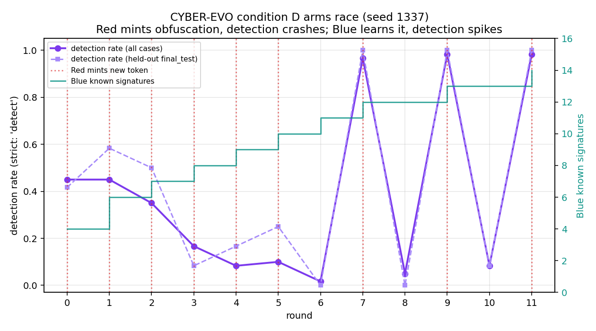
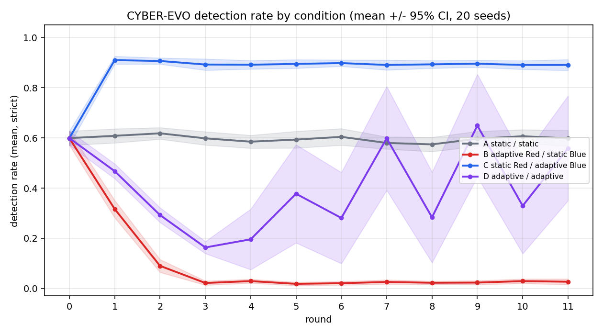

# Results — S001 Vertical Slice

This directory holds experiment outputs and run records. The first working
pipeline is the **S001 PowerShell vertical slice**: it takes the project from
specification-only to an end-to-end run that produces reproducible metrics.

## What the slice does

One round of the CYBER-EVO pipeline, each stage decoupled through on-disk
JSONL (no shared imports between agent directories):

```
environment/generate_telemetry.py   ->  telemetry/events.jsonl        (Blue-visible)
                                         telemetry/ground-truth.jsonl  (evaluator-only)
                                         telemetry/dataset-manifest.json
blue-agent/baseline_blue.py          ->  results/blue-decisions.jsonl
                                         results/blue-config.json
evaluation/evaluate.py               ->  results/metrics.json
experiments/run_slice.py             ->  results/run-<timestamp>.json  (repro record)
                                         results/latest-run.json
```

This is experimental **condition A**: a fixed scenario set vs. a static,
deterministic baseline Blue. It gives the adaptive and co-evolution conditions
a reproducible floor to measure against, with zero model/API cost.

## How to run

```bash
python experiments/run_slice.py --seed 1337
```

Options: `--seed <int>`, `--n-cases <int>`, `--condition <label>`. Each run is
fully determined by its seed and is recorded in `results/run-<timestamp>.json`
(seed, agent version + config, schema version, splits, telemetry config, git
commit, timestamp, metric summary).

Stages can also be run individually; they communicate only through the JSONL
files above.

## Baseline result (seed 1337, 60 cases, 30 attack / 30 benign)

Strict scoring: only a `detect` decision counts as a positive; `investigate`
is a valid third outcome and is tallied separately.

| Slice        | Precision | Recall (detection) | FPR | F1   | investigate (atk/benign) |
| ------------ | --------: | -----------------: | --: | ---: | ------------------------ |
| Overall      |      1.00 |               0.27 | 0.0 | 0.42 | 34 (27 / 7)              |
| final_test   |      1.00 |               0.17 | 0.0 | 0.29 | 6 (5 / 1)                |

By telemetry condition:

| Condition | Recall | Precision | Notes                                            |
| --------- | -----: | --------: | ------------------------------------------------ |
| clean     |   0.40 |      1.00 | best observation quality                         |
| delayed   |   0.40 |      1.00 | outcome unaffected (latency not modelled in v1)  |
| missing   |   0.00 |  undefined | `command_line` nulled → main signal removed      |
| noisy     |   0.00 |  undefined | see small-n caveat below                         |

Label-leakage check: **pass** (Blue evidence references observed fields only).

## Interpretation

- The baseline is high-precision, zero-FP, but low-recall: it routes most
  attacks to `investigate` rather than firing `detect`. That triage load is a
  real operational cost and is reported, not hidden.
- **Missing** telemetry measurably suppresses detection (recall → 0) and pushes
  benign look-alikes into triage — direct evidence for hypothesis 4 (degraded
  observability hurts both teams).
- `undefined` precision under `missing`/`noisy` means zero positive
  predictions, reported as undefined rather than silently 0 (per the schema's
  metric rules).

## Known limitations (v1)

- Per-condition cells are small (n = 8–14), so condition effects are noisy; the
  `noisy` recall of 0.0 is largely a sampling artifact of which attacks drew
  that condition at this seed. Repeat across seeds / raise `--n-cases` for
  stable per-condition estimates (the design doc already requires repeated
  runs).
- Cases are pre-segmented by `case_id`; a later version should make Blue
  segment the raw stream by host/time window itself.
- Detection latency is not modelled (no decision-time), so the `delayed`
  condition is scored on outcome only.
- Single scenario (S001) and a static baseline Blue — Red adaptation, adaptive
  Blue, and additional techniques are the next increments.

## Next

1. Red agent that mutates S001 attacks (encoding, parent, timing) → enables
   conditions B/D and attack-variant generalization.
2. Adaptive Blue (threshold/rule learning on the adaptation split only).
3. Co-evolution loop over multiple rounds (the core research condition).
4. Add scenarios S002–S008 for true unseen-technique / unseen-chain tests.
5. LLM-backed Blue behind the same contract (local llama3.2 first).

---

# Co-Evolution — Conditions A–D

The co-evolution loop (`experiments/coevolution.py`) runs repeated Red/Blue
rounds over a **stable case pool** (`environment/case_pool.py`): each case's
identity, label and split are fixed for the whole experiment, but the Red agent
re-renders attack telemetry every round under its evolving strategy, so a
held-out case stays held out while the observations it produces change.

* **Red** (`red-agent/red_agent.py`) evades along two dimensions — spawn from a
  benign parent (kills Blue's parent signal) and use a freshly obfuscated
  signature Blue does not yet know. When adaptive, it reinforces whatever
  produced a clean `no_alert` and **mints a new obfuscation token** once its
  current one stops slipping past.
* **Blue** (`blue-agent/adaptive_blue.py`) scores `anomalous parent + known
  signature`; a strong IOC (explicit obfuscation marker, hard encoding) alone
  warrants `detect`, a dual-use flag only `investigate`. When adaptive, it
  learns signatures from confirmed attacks **in the adaptation split only** —
  never validation or final_test.

## How to run

```bash
python experiments/coevolution.py --all --rounds 12 --seed 1337   # one seed, 4 conditions
# or one condition: --condition D
python experiments/seed_sweep.py --seeds 20 --rounds 12           # mean +/- 95% CI
python experiments/plot_coevolution.py                            # figures (needs matplotlib)
```

Writes `results/coevolution-<cond>-<timestamp>.json` (full per-round series +
strategy snapshots), `results/coevolution-summary.json`, `results/seed-sweep.json`,
and figures under `results/plots/`.

## Result (seed 1337, 12 rounds, 60 attack / 60 benign)

Detection rate is strict (only `detect` counts); ASR = 1 − detection rate.

| Cond | Red / Blue        | Detection (r0 → r11) | ASR (r0 → r11) | Benign→investigate | Tokens minted |
| ---- | ----------------- | -------------------- | -------------- | ------------------ | ------------- |
| A    | static / static   | 0.45 → 0.65          | 0.55 → 0.35    | 0                  | 0             |
| B    | adaptive / static | 0.45 → **0.03**      | 0.55 → **0.97**| 0                  | 3             |
| C    | static / adaptive | 0.45 → **0.95**      | 0.55 → **0.05**| 10 / round         | 0             |
| D    | adaptive / adaptive | **oscillates 0.02 ⇄ 0.98** | **0.98 ⇄ 0.02** | 10 / round | 8             |

## Findings vs. the hypotheses

1. **Static defense degrades (H1).** Condition B: an adaptive attacker drives a
   fixed Blue to near-zero detection (ASR 0.97) within ~4 rounds by removing the
   parent signal and switching to an unknown obfuscation.
2. **Adaptive defense generalizes (H2).** Condition C: Blue learns the two
   signatures a fixed Red reuses and reaches 0.95 detection — including on the
   held-out final_test split (det_FT → 1.00), so it generalizes rather than
   memorizes.
3. **Adaptation has a cost (H3).** The moment adaptive Blue learns the dual-use
   `-ep_bypass` flag (C and D, round 1), 10 benign cases per round move into
   `investigate`. Precision stays 1.0 — the cost is **analyst triage load**, not
   false positives, because a dual-use indicator only raises suspicion.
4. **Co-evolution oscillates (the arms race, D).** Red mints a fresh token →
   detection crashes to ~0.02; Blue learns it the next round → detection spikes
   to ~0.98; Red mints again → crash. Blue's signature set climbs monotonically
   (4 → 14) while Red mints 8 tokens. Neither side converges; the system cycles.
   The held-out split tracks the same cycle, so generalization itself is only as
   durable as the time since Red's last mutation.

## Seed sweep (20 seeds, 12 rounds)

Single-seed numbers are anecdotes. The sweep (`experiments/seed_sweep.py`) runs
each condition over 20 seeds and reports mean ± 95% CI.

| Cond | Detection (mean, all rounds) | ASR (last round) | Oscillation swing | Tokens minted | Blue sigs |
| ---- | ---------------------------: | ---------------: | ----------------: | ------------: | --------: |
| A    | 0.60 ± 0.01                  | 0.40 ± 0.03      | 0.07 ± 0.01       | 0.0           | 4.0       |
| B    | 0.10 ± 0.01                  | 0.97 ± 0.01      | 0.07 ± 0.00       | 2.2           | 4.0       |
| C    | 0.87 ± 0.01                  | 0.11 ± 0.02      | 0.07 ± 0.01       | 0.0           | 6.0       |
| D    | 0.40 ± 0.02                  | 0.44 ± **0.21**  | **0.52 ± 0.03**   | 8.0           | 13.5      |

The **oscillation swing** (mean absolute round-to-round change in detection)
isolates the arms race: A, B and C sit at ~0.07 (monotone or flat), while D is
**0.52 — about 7× higher**. D's last-round ASR has a wide CI (± 0.21) precisely
because the endpoint lands on a random phase of the oscillation — that variance
*is* the result, not noise to average away.

## Figures



*Condition D, one seed: strict detection (purple) crashes each time Red mints a
fresh obfuscation token (red lines) and spikes when Blue learns it; Blue's known
signatures (teal) ratchet up monotonically. The held-out split tracks the cycle.*



*All four conditions, mean ± 95% CI over 20 seeds. A/B/C converge with tight
bands; D's wide band is the oscillation variance.*

## Known limitations (co-evolution v1)

- Deterministic parametric agents, not LLMs — the strategy space is two evasion
  dials plus token minting. It is enough to produce the dynamics above; an
  LLM-backed Red/Blue behind the same contract is the next step.
- Single scenario (S001) and a single ambiguous indicator. More techniques and
  indicators would let FPR (not just triage load) move.
- Oscillation period is ~1 round because learning and minting are both
  single-step; richer memory/forgetting would change the cycle shape.
- The sweep covers 20 seeds at one pool size / round count; a fuller study would
  also vary pool size, round count and learning rate.

---

# Real-Data Detection — LSASS new-instance generalization (T1003.001)

This moves the project off self-written telemetry onto real host telemetry and
asks the question that motivates the whole thesis on real data: **does a
detector that works on known attack procedures generalize to unseen procedures
of the same technique?**

## Setup

- **Data:** Open Threat Research Forge Security-Datasets (MIT). The seven
  `LSASS_campaign_0X` datasets each run *one tool* for OS Credential Dumping:
  LSASS Memory (T1003.001) — mimikatz, procdump, comsvcs, out-minidump,
  sharpdump, outflank-dumpert, nanodump. **354,229 real Windows/Sysmon events.**
- **Ingest:** `environment/otrf_loader.py` → leakage-free contract
  (detector-visible `events.jsonl` + evaluator-only `labels.jsonl`). Ground
  truth is a documented derived rule (Sysmon EID10 ProcessAccess to lsass.exe
  with a memory-read mask from a non-system source).
- **Split (new-instance):** train on procedures 01–03, hold out 04–07 — unseen
  tools of the *same* technique.
- **Detectors:** `experiments/lsass_detectors.py` (signature, behavioral),
  `experiments/llm_detector.py` (local llama3.2 via Ollama, zero-shot),
  `experiments/llm_fewshot_detector.py` (same model, few-shot: labeled train
  exemplars in context, excluded from the train eval).

## Result — held-out (unseen) procedures

| Detector | Approach | Holdout recall | Holdout precision |
| --- | --- | ---: | ---: |
| signature | learns malicious tool image names from training | **0.29** | 1.00 |
| behavioral | technique invariant (non-system proc reads lsass w/ VM_READ) | **1.00** | 1.00 |
| llm (zero-shot) | llama3.2 3B judges each access event | 0.57 | 1.00 |
| llm (few-shot, 3+3) | same model, 6 labeled train exemplars in context | 0.71 | 1.00 |

Per-procedure recall (01–03 train, 04–07 holdout):

| | 01 | 02 | 03 | 04 | 05 | 06 | 07 |
| --- | --- | --- | --- | --- | --- | --- | --- |
| signature | 1.0 | 1.0 | 1.0 | 1.0 | **0.0** | **0.0** | **0.0** |
| behavioral | 1.0 | 1.0 | 1.0 | 1.0 | 1.0 | 1.0 | 1.0 |
| llm (zero-shot) | 1.0 | **0.0** | 0.5 | 1.0 | **0.0** | 0.5 | 1.0 |
| llm (few-shot) | –¹ | **0.0** | **0.0** | 1.0 | 0.5 | 1.0 | **0.0** |

¹ few-shot exemplars are drawn from the training procedures and excluded from
the training eval, so `campaign_01`'s only remaining attack events became
exemplars (no train-01 events left to score). Train recall is therefore
measured on 02/03 alone, where it is **0.00** (see finding 5).

## Findings

1. **Signature detection memorizes, it does not generalize.** Recall falls from
   1.00 to **0.29** on unseen tools — it catches only `campaign_04`, which
   reuses a training payload (`winx64_payload.exe`), and misses
   sharpdump/dumpert/nanodump entirely. It also pays a precision cost on
   training (0.50): it learned `rundll32.exe` — a LOLBin that legitimately
   accesses lsass — as an IOC, producing false positives.
2. **The technique invariant generalizes.** The behavioral detector holds at
   1.00 / 1.00 across all unseen tools. (Honest caveat: this rule encodes the
   same invariant used to derive ground truth, so its high recall is partly by
   construction; the scientific weight is on the signature collapse.)
3. **A small zero-shot LLM is unreliable — and fails in a mixed way.** llama3.2
   (3B) reaches only ~0.46 recall overall and is inconsistent: it **missed
   procdump at GrantedAccess `0x1fffff`** — the most blatant case — yet caught
   the obscure nanodump. It also produced a name-bias false positive (flagged a
   benign `0x1400` query because the image was named `winx64_payload`). So it
   neither reasons reliably on the access mask nor purely memorizes tool fame.
4. **A ten-line behavioral rule beats the 3B LLM here.** This tempers the "LLMs
   solve detection" framing and sets a concrete bar for the LLM experiments.
5. **Few-shot raises recall but does *not* teach the invariant.** Given six
   labeled training exemplars (3 dumps + 3 benign), holdout recall rises
   0.57 → **0.71** and precision stays 1.00 — on the face of it, in-context
   examples help. But the *error pattern* shows why they do not help where it
   matters. The model still catches unseen tools with *suspicious-looking
   names* (`winx64_payload`, `outflank-dumpert`) and still **misses the
   dangerous cases**: it judged `procdump.exe`/`procdump64.exe` at full access
   `0x1fffff` benign *even though it was shown procdump dumps as malicious
   exemplars*, missed the `rundll32.exe`+comsvcs LOLBin (`0x1410`), and missed
   stealthy `nanodump` (`0x1010`). Train recall on the non-exemplar seen tools
   (02/03) is **0.00** for exactly this reason: those are the legit-binary /
   LOLBin cases, and the model's prior ("procdump and rundll32 are legitimate
   signed tools") overrides the in-context examples. The few-shot gains are
   *name semantics*, not technique reasoning — so the LLM fails precisely on
   living-off-the-land abuse and low-footprint tooling, which is where real
   adversaries operate and where the behavioral invariant still holds 1.00.

## Honest caveats

- Few-shot now has a real train/holdout meaning (exemplars from training
  procedures, excluded from the training eval). The result is reported above;
  the headline is that few-shot improves raw recall without fixing the failure
  mode (finding 5).
- Only 13 attack events total (a dump is a handful of events), so recall is
  coarse; precision/FPR for the LLM are on a benign subsample.
- llama3.2 3B is small; a larger model may well do better — this is a result
  about *this* model, not "LLMs in general".
- Ground truth is a derived rule, not hand annotation; mild label noise possible.

# Ladder rung 2 — new-subtechnique (T1003.001 LSASS → T1003.003 NTDS)

The new-instance rung above changed the *tool* and kept the sub-technique. This
rung changes the **sub-technique**: train/exemplify everything on LSASS memory
dumping (T1003.001) and test on NTDS — stealing the Active Directory database
`ntds.dit` (T1003.003) — a different footprint of the *same* technique family
(OS Credential Dumping). The question: does anything that worked on LSASS carry
over to a sibling sub-technique it never saw?

## Setup

- **Data:** three OTRF atomic datasets, one tool each — `ntdsutil` (IFM
  snapshot), `volume_shadow_copy` (vssadmin + copy off the shadow), `ninjacopy`
  (Empire Invoke-NinjaCopy). **41,996 real Windows/Sysmon/Security events, 14
  attack events.**
- **Ingest:** `environment/ntds_loader.py` → same leakage-free contract. Ground
  truth: a Sysmon FileCreate(11) or Security object-access(4663) whose path
  basename is `ntds*.dit`, from a process other than `lsass.exe` (the legit DC
  directory-service owner).
- **Detectors:** the LSASS-trained signature + behavioral detectors, evaluated
  **unchanged** on NTDS (`experiments/ladder_subtechnique.py`); the LLM asked a
  **general** T1003 question (not LSASS-specific) on the NTDS surface, zero-shot
  and few-shot with LSASS exemplars (`experiments/llm_subtechnique_detector.py`).

## Result — transfer to the unseen sub-technique

| Detector | Trained / exemplified on | NTDS recall | NTDS precision |
| --- | --- | ---: | ---: |
| signature | LSASS tool names | **0.00** | n/a |
| behavioral (LSASS invariant) | LSASS EID10+VM_READ | **0.00** | n/a |
| llm (zero-shot, general T1003) | pretraining | 0.07 | 0.25 |
| llm (few-shot, general T1003) | LSASS exemplars | 0.07 | 1.00 |
| behavioral (NTDS invariant) | — *(separate, surface-matched rule)* | 1.00 | 1.00 |

## Findings

6. **The invariant that generalized across tools does NOT generalize across
   sub-techniques.** The behavioral detector that held 1.00 on every unseen
   LSASS tool scores **0.00** on NTDS — it is bound to the LSASS *surface*
   (EID10 ProcessAccess to lsass.exe with a memory-read mask), and NTDS leaves a
   file-copy footprint instead. The signature detector likewise scores 0.00.
   Generalization across instances is real but **surface-local**: it buys
   nothing across the sub-technique boundary. Only a *separate*, NTDS-matched
   invariant recovers detection (1.00) — i.e. each sub-technique needs its own
   rule.
7. **The LLM does not transfer either — and leans on lexical cues.** Given a
   general "is this OS Credential Dumping (T1003)?" prompt, llama3.2 reaches only
   **0.07** recall on NTDS. Its single catch is the one event whose path is
   literally `...\ntds.dit` being *created* (Sysmon EID11); it misses every
   Security-log object-access (4663) read of `ntds.dit` off a shadow copy, and
   misses VSS and NinjaCopy entirely. Few-shot LSASS exemplars change nothing on
   recall (still 0.07) and only clean up false positives (precision 0.25 → 1.00).
   So semantic reasoning keys on the surface string, not the technique — it does
   not connect a raw access handle on `ntds.dit` to credential theft.
8. **No approach dominates the ladder.** New-instance rewards the behavioral
   invariant; new-subtechnique punishes it (surface lock-in) and the LLM alike.
   The honest takeaway is that **detection generalization is bounded by the
   telemetry surface**: invariants transfer across tools within a surface,
   nothing here transfers across surfaces, and a small LLM substitutes lexical
   recognition for technique reasoning at both rungs. This is the paper's spine —
   a measured map of *where* each approach's generalization ends.

## Honest caveats (rung 2)

- Both NTDS invariants (the ground-truth rule and the NTDS-specific detector)
  encode the same observable, so the 1.00 is by construction; the weight is on
  the **0.00 transfer** of the LSASS detectors and the **0.07** LLM, which are
  not by construction.
- 14 attack events; recall is coarse. The LLM's NTDS precision is on a benign
  subsample of same-type file/object events.
- NTDS datasets are OTRF *atomic* (single-technique) captures, so there is no
  train split within NTDS — the whole sub-technique is held out, which is the
  point of the rung.

# Ladder rung 3 — new-technique (T1003 credential dumping → T1055 injection)

The last rung. Train/derive everything on credential dumping (T1003) and test
on **process injection** (T1055) — a different ATT&CK technique. The twist that
makes this rung sharper than NTDS: injection **shares the LSASS telemetry
surface**. Both raise Sysmon EID10 ProcessAccess (a handle into another
process). A dump opens `lsass.exe` for memory *read* (PROCESS_VM_READ);
injection opens an arbitrary target (often PROCESS_ALL_ACCESS) and then fires
Sysmon EID8 CreateRemoteThread. So the invariant does not merely face a new
surface — it faces the *same event type* with different intent.

## Setup

- **Data:** three OTRF atomic datasets, one tool each — `dll_injection`
  (Empire LoadLibrary + CreateRemoteThread), `pe_injection` (PurpleSharp),
  `lolbin_crt` (Covenant wuauclt LOLBIN). **14,218 real events, 3 attack
  events** (one CreateRemoteThread per procedure — the decisive injection act;
  GT is narrow by design, so recall is coarse).
- **Ingest:** `environment/injection_loader.py`. Ground truth: a Sysmon
  CreateRemoteThread (EID8) from a non-system source.
- **Detectors:** the credential-dumping rules (LSASS signature + behavioral,
  and the NTDS invariant), evaluated unchanged on injection
  (`experiments/ladder_technique.py`); the LLM asked a **general** "is this ANY
  malicious technique?" question (not T1003-specific), zero-shot and few-shot
  with T1003 exemplars (`experiments/llm_technique_detector.py`).

## Result — transfer to the unseen technique

| Detector | Built for | Injection recall | Injection precision |
| --- | --- | ---: | ---: |
| signature (LSASS) | T1003 tool names | **0.00** | n/a |
| behavioral (LSASS invariant) | T1003.001 EID10+VM_READ→lsass | **0.00** | n/a¹ |
| behavioral (NTDS invariant) | T1003.003 ntds.dit | **0.00** | n/a |
| llm (zero-shot, general malice) | pretraining | **0.00** | n/a² |
| llm (few-shot, general malice) | T1003 exemplars | **0.00** | n/a² |
| behavioral (injection invariant) | — *(separate, surface-matched rule)* | 1.00 | 1.00 |

¹ The LSASS invariant shares the EID10 surface with injection yet produces **0
false positives** — it keys on VM_READ *to lsass.exe*, so it correctly stays
silent on injection's handles. It discriminates; it just does not transfer.
² The LLM flagged **no** event on the injection slice as malicious, so precision
is undefined (TP+FP = 0).

## Findings

9. **Transfer is zero across the technique boundary — even on a shared
   surface.** Every credential-dumping rule scores 0.00 on injection. The LSASS
   behavioral invariant is the sharp case: injection raises the very EID10
   ProcessAccess events it inspects, but because it requires VM_READ *to
   lsass.exe* it neither fires (0 recall) nor misfires (0 FP). Generalization is
   not just surface-local (rung 2) — it is *intent*-local within a surface.
10. **The LLM collapses completely, and does not understand the primitive.**
    With a general "any malicious technique?" prompt, llama3.2 reaches **0.00**
    recall on injection, zero-shot and few-shot alike. It judged the literal
    CreateRemoteThread of `PurpleSharp.exe` into `notepad.exe` *benign*, with the
    reason "normal process execution event" — it does not connect EID8
    CreateRemoteThread to injection at all. T1003 exemplars do not help; there is
    no lexical cue (no "ntds.dit"-style string) to latch onto, and the model has
    no behavioral concept of the technique.
11. **The ladder is a monotone collapse for the LLM and a step function for the
    invariant.** Across the three rungs the small LLM degrades
    **0.71 → 0.07 → 0.00** as the test moves away from what it saw, while each
    hand-coded invariant is binary — 1.00 on its own surface, 0.00 on every
    other. Neither is a general detector: the invariant is a precise, narrow
    sensor that must be rebuilt per surface/intent; the LLM is a broad,
    shallow guesser whose apparent generality is lexical and evaporates off-
    distribution. **Detection generalization is bounded by the telemetry surface
    and the intent within it — that boundary, mapped rung by rung, is the
    contribution.**

# Ladder rung 4 — new-chain (isolated techniques → a full intrusion)

The last three rungs each held out a single technique in isolation. A real
intrusion is a *chain* of many techniques on a live host. This rung runs the
invariants---built and validated on tiny isolated atomic captures---**unchanged**
over the **MITRE ATT\&CK Evaluations APT29 Day 1** emulation (OTRF): one
multi-step Windows intrusion, **196,081 real host events**. It asks two things a
per-technique benchmark cannot.

## Setup

- **Data:** OTRF `compound/apt29/day1` (MITRE Evals APT29 Day 1), 196,081
  Sysmon/Security events from a full intrusion on a different host than the
  atomic slices. **Ingest:** `environment/apt29_loader.py` tags each event with
  the *same* three derived rules (LSASS T1003.001, NTDS T1003.003, injection
  T1055); only those three techniques are labeled, so the labels are an
  undercount of the chain's true malice.
- **Detectors:** the three behavioral invariants, unchanged
  (`experiments/ladder_chain.py`); and the general "any malicious technique?"
  8B LLM over the same handle/thread surface (`experiments/llm_chain_detector.py`).

## Result — cross-environment transfer and chain coverage

| | Recall | Precision | FP (over 196k) |
| --- | ---: | ---: | ---: |
| LSASS invariant (T1003.001, present) | 1.00 | 1.00 | 0 |
| injection invariant (T1055, present) | 1.00 | 1.00 | 0 |
| NTDS invariant (T1003.003, absent in day 1) | n/a | n/a | 0 |
| **whole invariant set (union)** | **1.00** | **1.00** | **0** |
| 8B LLM (general malice, judged subsample) | 0.80 | 0.15 | 23 |
| 14B LLM (general malice, judged subsample) | 0.60 | **1.00** | **0** |

The invariant set catches all 5 labeled attack events with **zero false
positives across all 196,081 events**, but its three rules cover only
**~15 % (3 of ~20)** of the techniques the APT29 Day 1 chain exercises. The 8B
LLM, run on the 5 attacks plus a 50-event benign subsample, flags **27 of 55
judged events** malicious (flag rate ~49 %): recall 0.80 but precision 0.15.
Scaling that same general LLM to **14B** flips the trade: it flags only **3 of
55**, all three real — precision **1.00** at recall **0.60** with **0 FP** —
trading two missed chain steps for the elimination of every false alarm.

## Findings

15. **Invariants transfer across environments and stay precise at scale.** The
    LSASS and injection invariants, derived on isolated atomic captures, fire on
    the APT29 chain's credential-dumping and injection steps at 1.00/1.00 with
    **0 false positives in 196k real, noisy events** — they neither miss the
    technique in a new environment nor drown in the stream. Surface-locked does
    not mean brittle: within its surface, an invariant is both portable and
    quiet.
16. **…but per-technique detection covers a sliver of the kill chain.** Three
    rules illuminate ~15 % of the chain's techniques; the credential dump and
    the injection light up, and the ~17 other steps (discovery, lateral
    movement, collection, persistence, exfil, …) are dark. Precise detection of
    a full intrusion would need a rule *per technique* — and rungs 2–3 showed
    each is a *separate* rule that does not transfer.
17. **The LLM buys coverage with an unusable false-alarm rate.** The 8B model
    flags ~49 % of judged events as malicious — catching 4 of 5 attacks (it
    missed a borderline `dwm.exe`→`csrss.exe` thread) but calling routine
    `svchost`→`svchost` `0x1000` handles attacks. Projected to the full stream
    that is tens of thousands of alerts; the invariants raise five. **Coverage
    and precision are in direct tension, and the detector family chooses which
    to sacrifice** — the narrow invariant gives precision without coverage, the
    LLM coverage without precision. Neither is deployable alone on a real chain.
    Scaling the LLM to 14B does not escape the tension: it moves to the *precise*
    end (precision 1.00, recall 0.60, 0 FP), the mirror of 8B's
    coverage-without-precision. Which end a model lands on is an operating point
    capacity selects, not a wall only small models hit.

## Honest caveats (rung 4)

- Only the three modeled techniques are labeled, so "coverage" is measured
  against the documented APT29 Day 1 technique count (~20), not a full per-event
  GT of the chain. The 5 labeled events include one borderline injection
  (`dwm.exe`→`csrss.exe`) — mild label noise; the invariant and GT agree by
  construction, the LLM dissents.
- The invariants' 1.00/1.00 is for the two techniques *present* in day 1; the
  weight is on the **0 FP in 196k** (not by construction) and the **coverage
  gap** (not by construction). LLM precision is on a benign subsample.

## The generalization ladder (summary)

| Rung | Changes | Surface invariant | Signature | LLM 3B (best recall) | LLM 8B (best recall / prec.) | LLM 14B (best recall / prec.) |
| --- | --- | ---: | ---: | ---: | ---: | ---: |
| 1 new-instance | tool, same sub-technique | **1.00** | 0.29 | 0.71 (by *name*) | **1.00 / 1.00** | **1.00 / 1.00** |
| 2 new-subtechnique | LSASS → NTDS | 0.00 / 1.00¹ | 0.00 | 0.07 (lexical) | **1.00 / 0.67** | **1.00 / 0.93** |
| 3 new-technique | T1003 → T1055 injection | 0.00 / 1.00¹ | 0.00 | 0.00 (no concept) | **0.67** / 0.13 | 0.33 / **0.50** |
| 4 new-chain | isolated → APT29 full intrusion | **1.00 / 1.00**² | — | — | 0.80 / 0.15 | 0.60 / **1.00** |

¹ *the LSASS invariant transfers 0.00 across the rung; a separate surface-matched
invariant scores 1.00 — a different rule each time. Nothing hand-coded transfers
down a rung.*
² *the invariant set transfers perfectly to the chain's own techniques (0 FP in
196k) but covers only ~15 % of the chain; the 8B LLM covers more at precision
0.15 (~49 % flag rate). Coverage vs. precision, not recall, is the chain-level
axis.*

## Scale ablation — does a bigger model change the ladder?

The rung 1–3 LLM results above use llama3.2 **3B**. Re-running every rung with
llama3.1 **8B**, then qwen2.5 **14B** (same local Ollama, identical prompts,
seeds, and benign subsamples — scale is the only variable) overturns the "LLMs
collapse down the ladder" reading, and replaces it with something sharper.

**Recall (transfer) — 3B → 8B → 14B:**

| Rung | 3B zero / few | 8B zero / few | 14B zero / few |
| --- | ---: | ---: | ---: |
| 1 LSASS new-instance | 0.57 / 0.71 | **1.00 / 1.00** | **1.00 / 1.00** |
| 2 NTDS new-subtechnique | 0.07 / 0.07 | **1.00 / 1.00** | **1.00 / 1.00** |
| 3 injection new-technique | 0.00 / 0.00 | **0.67** / 0.00 | 0.33 / 0.33 |

**Precision (false-alarm cost) — 8B degrades with ladder distance, 14B claws it
back at short distance:**

| Rung | 8B prec. (zero / few) | 14B prec. (zero / few) |
| --- | ---: | ---: |
| 1 LSASS | 1.00 / 1.00 | 0.88 / 1.00 |
| 2 NTDS | 0.26 / 0.67 | **0.78 / 0.93** |
| 3 injection | 0.13 / 0.00 | **0.50** / 0.33 |

## Findings (scale)

12. **Scale restores recall at every rung — the 3B monotone collapse is a
    small-model artifact.** 8B reaches 1.00 recall on both the new-instance and
    new-subtechnique rungs (vs 3B's 0.71 and 0.07) and 0.67 on the new-technique
    rung (vs 0.00). Decisively, 8B *understands the primitive* 3B did not: it
    flags the CreateRemoteThread of `powershell.exe`/`purplesharp.exe` into
    `notepad.exe` as injection, where 3B called the identical event "normal
    process execution." The cross-sub-technique and cross-technique boundaries
    that stopped the small model do not stop the bigger one.
13. **The cost moves to precision, and it worsens the further the test is from
    the trained surface.** 8B precision falls 1.00 (rung 1) → 0.26–0.67 (rung 2)
    → 0.13 (rung 3). It transfers by becoming a *broad, trigger-happy* detector:
    on injection it flags ordinary process-access handles (`svchost→svchost`,
    `explorer→conhost`, even `lsass→taskhostw`) as malicious to catch the two
    real injections. A hand-coded invariant is precise and silent off its
    surface; the LLM at scale is the opposite — it covers everything and cries
    wolf, more so with distance. **The ladder is not a recall cliff but a
    precision/recall frontier that shifts with model size.**
14. **In-context examples are directional, not free — off-target exemplars
    hurt.** Few-shot helps only when the exemplars match the test's technique
    family: on NTDS (still OS Credential Dumping) LSASS exemplars hold recall at
    1.00 while lifting precision 0.26 → 0.67; on injection (a different
    technique) the same T1003 exemplars *destroy* recall, 0.67 → 0.00 — they
    anchor the model to "credential dumping" so it rejects the injection events
    it otherwise caught. Priming an LLM with the wrong technique's examples is
    worse than priming it with none.
15b. **14B — capacity recovers precision at short distance only.** Scaling once
    more to qwen2.5 **14B** answers the question finding 13 raised (does more
    capacity recover the precision 8B loses, or only slide along the frontier?),
    and the answer depends on distance. At the **near** rungs it recovers it
    while holding recall: new-subtechnique precision climbs 0.67 → **0.93**
    (few-shot) and 0.26 → **0.78** (zero-shot) at recall 1.00 — a strict Pareto
    gain over 8B, not a trade. At the **far** rung it does not: new-technique 14B
    sits at recall 0.33 / precision 0.50, trading away the recall 8B had (0.67)
    for precision rather than winning both; on the full chain it flags 3/55
    all-real (precision 1.00, recall 0.60, 0 FP). Capacity thus moves the model
    *along* the precision/recall frontier — dissolving the trade at short
    distance and pushing the wall one rung further out — but the far-rung wall
    persists. 8B's precision collapse is largely a capacity limit near the
    trained surface and a genuine frontier far from it.

## Honest caveats

- 14B is still a local model on a 6 GB-VRAM laptop (CPU-offloaded); a frontier /
  tool-calling model is the remaining scale point — would it break the far-rung
  wall 14B only pushes outward, or slide along the same frontier?
- Attack-event counts are small per rung (7 / 14 / 3), so recall is coarse; the
  LLM precision figures are on benign subsamples. The surface-matched invariants'
  1.00 values remain by construction — the weight is on the *transfer* numbers.
- Results are for llama3.2 3B, llama3.1 8B and qwen2.5 14B specifically; the
  *shape* (recall rises with scale, precision recovers with scale at short
  distance but only trades against recall far from the trained surface) is the
  claim, not the exact values.

## Next

1. ~~Larger LLM — does scale fix the blind spots?~~ **Done** (findings 12–14,
   15b): 8B restores recall at every rung but pays a precision collapse that
   grows with ladder distance; **14B** recovers that precision at short distance
   (Pareto over 8B) but only trades recall for precision at the far rungs.
   `experiments/llm_detector.py` etc. with `--model llama3.1:8b` / `qwen2.5:14b`,
   outputs `results/*-8b.json` / `results/*-14b.json`. Next scale point: a
   frontier / tool-calling model — does it break the far-rung wall, or slide
   along the same frontier?
2. Multi-step chains (OTRF `apt29`, `Log4Shell`) — a new-*chain* rung: does
   detecting individual techniques transfer to a full attack sequence?
3. Cross-dataset test on Windows-APT 2025 (CC BY) — real unseen environment.
4. ~~Adaptive adversary: a Red that mutates the tool to evade a signature Blue
   that keeps learning names — the co-evolution arms race on real telemetry,
   tied back to the ladder.~~ **Done** (rung 5 below,
   `experiments/coevolution_real.py`, `results/coevolution-real.json`).

# Ladder rung 5 — adaptive adversary (the arms race, measured on real telemetry)

The ladder rungs 1–4 hold the attacker *fixed* and move the test. This rung lets
the attacker **move too**: a Red that mutates its tool to evade the defender,
run over the real OTRF LSASS slice (7 campaigns = 7 real credential-dumping
tools, 354k events). It ties the released co-evolution engine to the measured
ladder and answers the obvious objection — *"your invariants only win because
the attacker never adapts."*

## Setup

- **Data:** the same leakage-free LSASS slice (T1003.001, 7 tools, 13 attack
  events). Red's mutation space is the set of real tools; no synthetic events.
- **Red (tool swapper):** deploys one real tool per round. When **adaptive**, if
  the defender's signature caught the current tool, Red *mints* — switches to a
  real tool whose image the signature has **not** learned (a disjoint-image
  dumper from the slice). Static Red holds one tool.
- **Blue — two detectors side by side** (`experiments/coevolution_real.py`,
  reusing `lsass_detectors.py`):
  - **signature**: an IOC blocklist of malicious `SourceImage` basenames, seeded
    with the one tool the SOC already blocks (`procdump`). When **adaptive**, it
    learns the current tool's image at the end of each round (post-incident
    forensics) — so it is always one round behind an escaping Red. Static holds
    its seed.
  - **behavioral invariant**: non-system process opening `lsass.exe` with a
    memory-read mask. Tool-agnostic, **never adapts** — the arms-race-proof
    control, reported in every condition.
- **Conditions** (Red adaptive × signature-Blue adaptive): A static/static,
  B adaptive/static, C static/adaptive, D adaptive/adaptive. 12 rounds.

## Result — signature recall per round (invariant in parallel)

| Cond | Red / sig-Blue | signature recall over rounds | invariant | Red tools minted |
| --- | --- | --- | --- | --- |
| A | static / static | 1.00 flat | **1.00 flat** | 0 |
| B | adaptive / static | 1.00 → **0.00** (round 1 on, forever) | **1.00 flat** | 1 |
| C | static / adaptive | 1.00 flat | **1.00 flat** | 0 |
| D | adaptive / adaptive | **1 0 1 0 1 0 1 0** then pinned 1.00 | **1.00 flat** | 4 |

Condition **D** round by round (seed tool `procdump`): procdump `1.00` (mint →
mimikatz) · mimikatz `0.00` (learn `winx64_payload`) · mimikatz `1.00`/prec
**0.25** (mint → sharpdump) · sharpdump `0.00` (learn) · sharpdump `1.00` (mint →
outflank) · outflank `0.00` (learn) · outflank `1.00` (mint → nanodump) ·
nanodump `0.00` (learn) · nanodump `1.00`/prec **0.50** — **pinned**: Red has no
disjoint-image tool left, oscillation ends. The blocklist ratchets 2 → 6 images;
the invariant is `1.00 / 1.00` every single round and learns nothing.

**Ladder probe.** The arms-race-hardened blocklist (all 6 learned images) tested
on NTDS (rung 2, T1003.003): recall **0.00** (TP 0, FP 0, FN 14) — it cannot
even *express* an NTDS detection.

## Findings

18. **The signature faces a real arms race; the invariant does not.** Against an
    adaptive Red, a static blocklist collapses permanently (B: recall → 0.00
    after one escape, ASR 1.00) and an adaptive blocklist only oscillates (D:
    recall `1 0 1 0`, mean ~0.5) — Red is always one unseen tool ahead of what
    forensics taught Blue last round. The behavioral invariant holds **1.00 / 1.00
    in every round of every condition**: a tool swap does not change the EID10
    VM_READ→lsass surface, so there is nothing for Red to evade. Adaptation is
    not what wins; **being bound to the technique's surface instead of its tool
    is.**
19. **Hardening has a precision tax and a finite — but artificially finite —
    endgame.** The growing blocklist starts flagging benign look-alikes (prec
    0.25 then 0.50 as it learns shared/LOLBin names like `winx64_payload`,
    repeating the rung-1 `rundll32` false-positive). The arms race here
    *terminates* only because these 7 real tools happen to share image names, so
    Red runs out of disjoint-image escapes and gets pinned (D rounds 8–11).
    Remove that artificial limit (the unbounded-rename adversary below) and the
    treadmill never terminates — the invariant's flat 1.00 is the only stable
    outcome.
20. **The arms race and the ladder are the same axis.** Red's only escape from
    the invariant is to leave its telemetry surface — i.e. change the technique
    (climb to rung 2/3), which is exactly where the invariant also fails (and
    needs a new surface-matched rule). So *cheap* adaptation (mutate the tool
    within a surface) is the arms race, and *expensive* adaptation (change the
    technique across a surface) is the ladder; they are one axis measured from
    two ends. The ladder probe closes it: the blocklist hardened by the entire
    LSASS arms race scores **0.00** on NTDS — within-surface hardening transfers
    nothing across a ladder boundary, the same surface-lock the hand-built
    invariants showed in rungs 2–3.

## Robustness and the unbounded adversary

Two follow-on runs harden the rung against the obvious objections
(`experiments/coevolution_real.py --sweep` and `--red-mode rename`).

**Seed robustness — does the story depend on which tool Blue starts from?** No.
Condition D (tool-swap, 12 rounds) run once per possible seed tool is identical
across all seven:

| Seed tool | signature mean recall | oscillation swing | invariant min | Red minted |
| --- | ---: | ---: | ---: | ---: |
| every one of the 7 | 0.67 | 0.73 | **1.00** | 4 |

The arms-race dynamics (oscillate, bloat, pin) and the flat invariant are
seed-invariant — not an artefact of seeding with `procdump`.

**Unbounded adversary — what if Red is not limited to 7 real tools?** The
`rename` Red relabels the real attack events with a *fresh* image name every
round (the surface — EID10, VM_READ, target `lsass.exe` — is untouched). Now the
signature treadmill **never terminates** (`results/coevolution-real-rename.json`):

| Cond | signature recall over 12 rounds | blocklist size | invariant |
| --- | --- | ---: | --- |
| B adaptive / static | **0.00 every round** (never catches up) | 2 (frozen) | **1.00 flat** |
| D adaptive / adaptive | `0 1 0 1 0 1 …` forever, Red mints every catch | **2 → 8 and climbing** | **1.00 flat** |

Unlike the finite tool pool (which pinned at round 8), the rename adversary keeps
minting indefinitely and the blocklist grows without bound while never achieving
stable coverage. The invariant is unmoved — a rename does not touch the access
mask. This is the measured form of finding 19: against an attacker who can
rename freely, a signature layer is a strictly losing arms race, and only the
surface-bound invariant is stable.

## Honest caveats (rung 5)

- 13 attack events across 7 tools, so per-round recall is coarse and binary;
  the dynamics (escape, oscillation, pinning, flat invariant) are the result,
  not the exact per-round rates.
- The finite `swap` adversary's mutation space is the 7 real tools (a finite,
  image-sharing set), which is why *that* arms race terminates; the `rename`
  adversary lifts the limit and shows the non-terminating case. Both Reds are
  deterministic and parametric, not learned — a learned Red that generates
  *behaviorally* novel tooling (not just a new name) is the next adversary.
- The invariant's 1.00 is partly by construction (it encodes the GT surface);
  the weight is on the **signature collapse/oscillation** and the **0.00
  cross-ladder transfer**, neither of which is by construction.

# Layered detection — the constructive capstone

Rungs 1–5 are a *map* of where each detector family fails. The defender's
question is constructive: if you **stack** the precise surface invariant under
the broad LLM, what operating point do you get at each ladder distance?
`experiments/ensemble_ladder.py` answers it **offline** — it reuses the per-event
verdicts the 14B LLM detectors already wrote and recomputes, on the *identical*
judged events, the decision of the invariants the defender has **already built
for known techniques** (never a rule for the rung's own novel technique — that
is the ladder premise). The LSASS rule applied to an NTDS or injection event
simply does not fire, so this reproduces the ladder's 0.00 cross-boundary
transfer rather than cheating with a surface-matched oracle.

## Result (recall/precision on the LLM-judged subsample, 14B)

| Rung | deployed invariant | 14B LLM | union | block tier (rec, FP) | triage adds |
| --- | ---: | ---: | ---: | --- | --- |
| 1 new-instance | **1.00 / 1.00** | 1.00 / 1.00 | 1.00 / 1.00 | rec 1.00, **0 FP** | +0 TP / +0 FP |
| 2 new-subtechnique | **0.00** | 1.00 / 0.93 | 1.00 / 0.93 | rec 0.00, 0 FP | **+14 TP / +1 FP** |
| 3 new-technique | **0.00** | 0.33 / 0.50 | 0.33 / 0.50 | rec 0.00, 0 FP | +1 TP / +1 FP |
| 4 new-chain | **1.00 / 1.00** | 0.60 / 1.00 | 1.00 / 1.00 | rec 1.00, **0 FP** | +0 TP / +0 FP |

*block tier = the deployed invariants (trusted, auto-actionable); triage tier =
the LLM judging only invariant-negatives (needs an analyst). "union" = inv OR llm,
the coverage ceiling of running both.*

## Findings

21. **Layering buys a zero-FP high-confidence tier — but only as wide as the
    rules you have already built.** Where a surface invariant exists for the
    technique (rung 1, and the chain's covered techniques), the block tier
    catches everything at **0 false positives** and the LLM adds nothing (+0/+0):
    the invariant alone is the detector, and it is safe to auto-action. The LLM
    layer is pure redundancy there.
22. **At a genuinely new technique the stack collapses to LLM-only triage.** On
    rungs 2–3 the deployed invariants are silent (0.00, the ladder transfer), so
    the union *is* the LLM — it inherits the LLM's recall and its false positives
    (rung 2: +14 TP but +1 FP; rung 3: a thin +1 TP/+1 FP because the LLM is itself
    weak off-surface). There is no high-confidence tier to fall back on until a
    defender writes the new surface rule — which rungs 2–3 showed is a *separate*
    rule that does not transfer.
23. **The stack never beats the frontier; it exposes which tier you get.** Union
    recall/precision never exceeds the better of its two members at any rung —
    stacking does not escape the coverage/precision trade. Its entire value is
    the *free, auto-actionable block tier*, and the reach of that tier is exactly
    the defender's accumulated surface rules. Ladder distance — how far the live
    technique sits from the nearest rule you have written — decides whether you
    get a 0-FP block tier or are left on noisy LLM triage. This is the
    operational form of the whole paper: build invariants for the techniques you
    can anticipate (precise, stackable, auto-actionable), and keep a broad model
    as the second-stage net for the distance you have not yet covered.

## Honest caveats (layering)

- All three detectors are scored on the LLM's judged subsample (attacks + a
  seeded benign subsample), not the full stream, so the invariant recall/precision
  here is on that subsample and is not the 196k-event figure of rung 4; the
  comparison is valid because all three see identical events.
- The chain block tier is 1.00 because the chain's *labels* cover only the three
  techniques the invariants encode (the rung-4 undercount caveat); the real
  coverage gap is the unlabeled techniques, which this subsample does not measure.
- Uses the best-recall 14B config per rung (few-shot rungs 1–2, zero-shot rung 3);
  a different LLM or config shifts the triage-tier numbers, not the structure.
